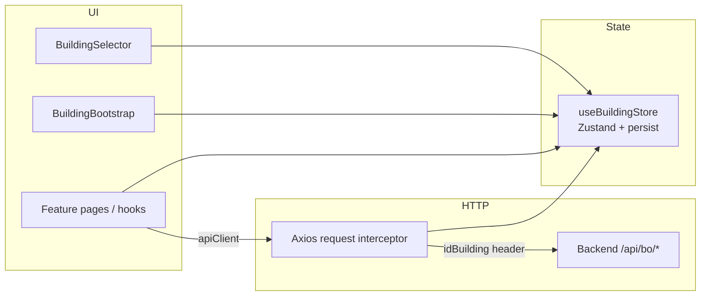

# Passing `idBuilding` — implementation guide

This document describes how the backoffice sends the active **Building** context to the API via the `idBuilding` HTTP header, and how that context is stored, bootstrapped, and switched in the UI.

---

## Overview

Many backoffice endpoints are **building-scoped**: the backend expects to know which Building the operator is working on. Rather than threading a building id through every hook, route, and API call, the app:

1. Keeps the selected building in a **global Zustand store** (persisted in `localStorage`).
2. **Automatically attaches** the `idBuilding` header on every relevant Axios request.
3. Exposes a **header selector** so operators can change building; switching invalidates cached data for building-scoped features.

The header name is exactly `idBuilding` (see `BUILDING_HEADER_NAME` in `src/core/building/building-header.ts`).

---

## Architecture



| Layer | Responsibility |
|-------|----------------|
| `building.store.ts` | Source of truth: `buildingId`, `buildingLabel`, user sync, persistence |
| `building-header.ts` | Rules for when to attach the header |
| `client.ts` | Axios interceptor reads store and sets header |
| `BuildingBootstrap.tsx` | Hydration, user change, auto-select, stale-id cleanup |
| `BuildingSelector.tsx` | Operator UI + cache invalidation on change |
| Feature `hooks/` | Call APIs normally — no manual header handling |

All building-context code lives under `src/core/building/` and is re-exported from `src/core/building/index.ts`.

---

## 1. HTTP header injection

### Axios interceptor

Both `apiClient` and `multipartClient` register the same request interceptor in `src/core/api/client.ts`:

```ts
function attachBuildingHeader(config: InternalAxiosRequestConfig) {
  if (!shouldAttachBuildingHeader(config.url)) {
    return config;
  }

  const { buildingId } = useBuildingStore.getState();

  if (buildingId != null) {
    config.headers.set(BUILDING_HEADER_NAME, String(buildingId));
  }

  return config;
}
```

Important details:

- The interceptor uses **`useBuildingStore.getState()`** (not a React hook), so it works outside components and always reads the latest persisted value.
- The header is only set when `buildingId` is non-null. If no building is selected, requests go out **without** `idBuilding` (the backend may reject them for scoped routes).
- Both JSON and multipart clients share this behavior (file uploads are building-scoped too).

### When the header is attached

`shouldAttachBuildingHeader()` in `src/core/building/building-header.ts`:

| Condition | Attach `idBuilding`? |
|-----------|----------------------|
| URL is missing | No |
| URL contains `/api/auth/` | No |
| URL contains `/api/bo/v1/buildings/select` | No |
| URL contains `/api/bo/` | Yes |
| Anything else (e.g. non-BO paths) | No |

**Exempt routes**

- **Auth** (`/api/auth/*`) — session endpoints must not depend on building context.
- **Buildings select** (`GET /api/bo/v1/buildings/select`) — used to populate the selector before a building is chosen; sending `idBuilding` would be circular or wrong.

All other `/api/bo/` calls (FAQs, users, apartments, building CRUD, etc.) receive the header when a building is selected.

---

## 2. Global store (`useBuildingStore`)

File: `src/core/building/building.store.ts`

### State shape

| Field | Type | Purpose |
|-------|------|---------|
| `buildingId` | `number \| null` | Active building id (sent as `idBuilding`) |
| `buildingLabel` | `string \| null` | Display name for UI |
| `ownerUserId` | `string \| null` | User who last selected the building |
| `hasHydrated` | `boolean` | `true` after Zustand rehydrates from `localStorage` |
| `selectorLocked` | `boolean` | When `true`, freezes the header `BuildingSelector` (e.g. while a create/edit dialog is open). **Not** persisted. |

### Actions

- **`setBuilding(id, label)`** — set active building.
- **`clearBuilding()`** — clear id and label.
- **`syncForUser(userId)`** — on login, associate store with user; if a **different** user logs in, clear building selection (prevents leaking context across accounts).
- **`setHasHydrated(value)`** — set by persist middleware after rehydration.
- **`lockSelector()`** / **`unlockSelector()`** — set/clear `selectorLocked` (UI-only; not written to `localStorage`).

### Persistence

- Storage key: `devx-react-bo-building` (Zustand `persist` middleware).
- Persisted fields: `ownerUserId`, `buildingId`, `buildingLabel` (not `hasHydrated`, not `selectorLocked`).
- On rehydrate, `hasHydrated` is set to `true` so bootstrap logic can wait for restored state before fetching options.

---

## 3. Bootstrap (`BuildingBootstrap`)

Rendered once inside `MainLayout` (`src/components/layout/main/MainLayout.tsx`). It renders `null` — it only runs side effects.

Responsibilities:

1. **User sync** — when `useAuthMe()` returns a user, call `syncForUser(user.userId)`.
2. **Wait for hydration** — `useBuildingsSelect` is enabled only when `user` exists and `hasHydrated` is true.
3. **Validate persisted id** — if `buildingId` is set but no longer appears in select options, call `clearBuilding()` (e.g. access revoked).
4. **Refresh label** — if the id is valid but the label changed on the server, update via `setBuilding`.
5. **Auto-select** — if there is no selection and exactly **one** building is available, select it automatically (once per session via `autoSelectedRef`).

This ensures a consistent building context after refresh, login, or single-building tenants without forcing the user to open the selector every time.

---

## 4. Building selector UI

`BuildingSelector` in the app header (`src/components/layout/header/Header.tsx`) lets operators change building.

On change:

1. `setBuilding(nextId, label)` or `clearBuilding()`.
2. **`invalidateBuildingScopedQueries(queryClient)`** — refetches data for roots: `users`, `apartments`, `faqs`, `buildings`, `building-context`.

If the user only has one building, `disableClearable` prevents clearing the selection.

The selector reads options from `GET /api/bo/v1/buildings/select` via `useBuildingsSelect()` (no `idBuilding` header on that call).

---

## 5. Building info (explicit id in URL)

Some endpoints need the building id in the **path**, not only the header. Example:

- `GET /api/bo/v1/buildings/{id}/info` — stats for the dashboard (`BuildingInfoStats`, `useBuildingInfo`).

`useBuildingInfo(buildingId)` takes the id from the store in components; the request still goes through `apiClient`, so `idBuilding` is also attached when applicable. Path and header stay aligned when the store is the source of truth.

---

## 6. How feature modules use building context

### Default pattern (header only)

Feature hooks should **not** pass `buildingId` in query strings or request bodies unless the API contract requires it. Examples:

```ts
// FAQs list — backend scopes by idBuilding header
useQuery({
  queryKey: faqsKeys.list(),
  queryFn: () => apiList(FAQS_ENDPOINT),
});
```

The interceptor adds `idBuilding` automatically. No changes needed in `useGet`, `useSend`, or per-feature `api.ts` files.

### UI that depends on selection

Read from the store when the UI should hide or adapt:

```ts
const buildingId = useBuildingStore((state) => state.buildingId);
const buildingLabel = useBuildingStore((state) => state.buildingLabel);
```

Used on `HomePage`, `MainLayout` (stats bar), etc.

### After adding a new building-scoped feature

1. Implement CRUD hooks calling `/api/bo/...` as usual.
2. Add your React Query root key to `BUILDING_SCOPED_QUERY_ROOTS` in `building.store.ts` if lists should refresh when the user switches building in the header.
3. Do **not** add mapper functions for building id in `model.ts` — the header handles transport.

---

## 7. File reference

| File | Role |
|------|------|
| `src/core/building/building-header.ts` | Header name + attach rules |
| `src/core/building/building.store.ts` | Zustand store + query invalidation helper |
| `src/core/building/building.api.ts` | Select/info endpoints + query keys |
| `src/core/building/building.hooks.ts` | `useBuildingsSelect`, `useBuildingInfo` |
| `src/core/building/building.model.ts` | `BuildingInfoDto` |
| `src/core/building/components/BuildingBootstrap.tsx` | Init / auto-select / validation |
| `src/core/building/components/BuildingSelector.tsx` | Header autocomplete |
| `src/core/building/components/BuildingInfoStats.tsx` | Building overview widgets |
| `src/core/api/client.ts` | Axios interceptors |
| `src/components/layout/main/MainLayout.tsx` | Mounts `BuildingBootstrap` + stats bar |
| `src/components/layout/header/Header.tsx` | Mounts `BuildingSelector` |

---

## 8. Request lifecycle (example)

1. Operator selects Building `42` in the header → `setBuilding(42, "Residenza Alfa")` → persisted to `localStorage`.
2. User navigates to `/faqs` → `useFaqsList()` runs → `GET /api/bo/v1/faqs`.
3. Interceptor sees `/api/bo/`, reads `buildingId: 42`, sets header `idBuilding: 42`.
4. Backend returns FAQs for building 42.
5. Operator switches to Building `7` → store updates → `invalidateBuildingScopedQueries` → FAQ list refetches with `idBuilding: 7`.

---

## 9. Testing checklist

- [ ] Login with one building → auto-selected, API calls include `idBuilding`.
- [ ] Login with multiple buildings → no auto-select until user chooses (or persisted choice restored).
- [ ] Switch building in header → lists/stats refresh, header value updates on all pages.
- [ ] Logout / different user login → previous user's building not reused.
- [ ] `GET /api/bo/v1/buildings/select` and `/api/auth/*` never send `idBuilding`.
- [ ] Refresh page → persisted building restored after hydration, then validated against select options.

---

## 10. Related docs

- [AGENTS.md](../AGENTS.md) — project overview and feature layout.
- [REACT.md](../REACT.md) — CRUD scaffold, hooks, and naming conventions.
